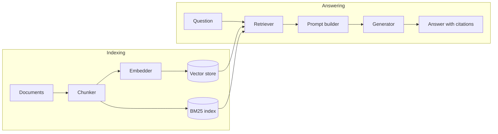

# raglab


raglab is a small Python project for learning how Retrieval Augmented Generation (RAG) works by reading and running every part of it.

It implements the whole RAG loop in plain Python with no runtime dependencies: loading documents, splitting them into chunks, turning chunks into vectors, searching, building a grounded prompt and producing an answer with citations. Each stage is a short module you can read next to the explanation in [docs/how_rag_works.md](docs/how_rag_works.md). When you want answers written by a real language model, you can swap the offline generator for any OpenAI compatible API, including a local Ollama server.

I built it as a study project, so the code favors readable algorithms over speed.

## Why RAG exists

A language model answers from what it saw during training. It has never read your company handbook, last week's release notes or the contract in your inbox, and when it lacks the facts it tends to produce something that sounds right anyway.

RAG adds a lookup step. Before the model writes anything, the system searches your documents for passages related to the question and puts them in the prompt, along with an instruction to answer only from that text. The model gets the facts it needs, every claim can point to its source, and updating what the system knows means editing documents instead of retraining a model.

## How the pipeline fits together



| Stage | What it does | Module |
| --- | --- | --- |
| Load | Reads `.md` and `.txt` files into `Document` objects | [documents.py](src/raglab/documents.py) |
| Chunk | Packs sentences into chunks of at most `max_chars`, repeating a sentence between neighbors so facts are not cut in half | [chunking.py](src/raglab/chunking.py) |
| Embed | Turns text into vectors with feature hashing or TFIDF | [embeddings.py](src/raglab/embeddings.py) |
| Store | Keeps vectors in memory, ranks them by cosine similarity, saves them to JSON | [vectorstore.py](src/raglab/vectorstore.py) |
| Retrieve | Dense search, BM25 keyword search, or both merged with Reciprocal Rank Fusion | [retrievers.py](src/raglab/retrievers.py) |
| Augment | Builds a prompt with numbered sources and grounding rules | [prompting.py](src/raglab/prompting.py) |
| Generate | Picks the best supporting sentences offline, or calls a language model | [generation.py](src/raglab/generation.py) |
| Evaluate | Scores retrieval with hit rate, MRR and recall at k | [evaluation.py](src/raglab/evaluation.py) |

## Quick start

You need Python 3.10 or newer.

```bash
git clone https://github.com/gabrielcampeao/raglab.git
cd raglab
python -m venv .venv
```

Activate the environment with `source .venv/bin/activate` on macOS and Linux, or `.venv\Scripts\activate` on Windows. Then install the project:

```bash
pip install -e ".[dev]"
```

The folder `examples/data` holds a small help center for Orbit Notes, a fictional note taking app. Ask it a question:

```bash
raglab ask "How long do I have to request a refund?" --data examples/data
```

```text
Answer:
You can request a full refund within 30 days of your first payment on any paid plan. [1] To request a refund, open Settings, choose Billing and click Request refund, or email billing@orbitnotes.example with your account email. [1]

Sources:
  [1] refunds.md (score 0.0328)
  [2] refunds.md (score 0.0320)
  [3] getting_started.md (score 0.0161)
```

Add `--show-prompt` to print the exact prompt a language model would receive. `raglab search` lists the chunks a query retrieves with their scores, and `raglab evaluate` compares every retriever on a set of labeled questions:

```bash
raglab search "sync conflict" --data examples/data --retriever bm25
raglab evaluate --data examples/data --cases examples/eval_cases.json
```

## Using it from Python

```python
from raglab import RAGPipeline

pipeline = RAGPipeline()
pipeline.ingest_directory("examples/data")

answer = pipeline.ask("Is there a discount for students?")
print(answer.text)
for result in answer.sources:
    print(result.chunk.source, round(result.score, 4))
```

Every stage can be replaced. Pass a different retriever, generator or chunk size:

```python
from raglab import BM25Retriever, ExtractiveGenerator, RAGPipeline

pipeline = RAGPipeline(
    retriever=BM25Retriever(k1=1.2, b=0.75),
    generator=ExtractiveGenerator(max_sentences=1),
    max_chars=300,
    overlap=1,
    top_k=5,
)
```

To use a neural embedding model, subclass `Embedder`, implement `embed`, and pass it to `DenseRetriever`.

## Connecting a language model

The default `ExtractiveGenerator` runs offline and only quotes sentences from the retrieved chunks. `OpenAICompatibleGenerator` sends the prompt to any server that implements the OpenAI chat completions API.

| Variable | Purpose |
| --- | --- |
| `OPENAI_API_KEY` | API key, sent as a bearer token when set |
| `OPENAI_BASE_URL` | Server address, `https://api.openai.com/v1` by default |

With OpenAI:

```bash
export OPENAI_API_KEY=your_key
raglab ask "Can I get a refund for an App Store purchase?" --data examples/data --generator openai --model gpt-4o-mini
```

With a local model through [Ollama](https://ollama.com):

```bash
ollama pull llama3.2
raglab ask "Where is my data stored?" --data examples/data --generator openai --model llama3.2 --base-url http://localhost:11434/v1
```

From Python:

```python
from raglab import OpenAICompatibleGenerator, RAGPipeline

pipeline = RAGPipeline(generator=OpenAICompatibleGenerator(model="gpt-4o-mini"))
```

## Examples

| Script | What it shows |
| --- | --- |
| [01_quickstart.py](examples/01_quickstart.py) | Index the sample data and answer a few questions, including one the documents cannot answer |
| [02_inspect_pipeline.py](examples/02_inspect_pipeline.py) | Print the output of every stage: documents, chunks, scores, prompt and answer |
| [03_compare_retrievers.py](examples/03_compare_retrievers.py) | Measure dense, TFIDF, BM25 and hybrid retrieval on labeled questions |
| [04_persist_index.py](examples/04_persist_index.py) | Save a vector index to JSON, load it back and search it |
| [05_llm_generation.py](examples/05_llm_generation.py) | Generate answers with OpenAI or a local model |

Run any of them with `python examples/<name>.py`.

## Comparing retrievers

Output of `examples/03_compare_retrievers.py` on the twelve sample questions:

```text
retriever   k  hit rate    mrr  recall
dense       1      0.83   0.83    0.83
dense       3      1.00   0.92    1.00
tfidf       1      1.00   1.00    1.00
tfidf       3      1.00   1.00    1.00
bm25        1      1.00   1.00    1.00
bm25        3      1.00   1.00    1.00
hybrid      1      1.00   1.00    1.00
hybrid      3      1.00   1.00    1.00
```

The hashing embedder spreads words across a fixed number of slots, so unrelated words sometimes share a slot and a wrong chunk occasionally ranks first. TFIDF and BM25 weight rare words more heavily, which helps on a corpus this small. Hybrid search merges the dense and BM25 rankings and keeps the strengths of both. Twelve questions are far too few to judge a retriever, so treat these numbers as a demonstration of how to measure retrieval, not as a benchmark.

## Where RAG is used

[docs/use_cases.md](docs/use_cases.md) covers customer support assistants, internal knowledge bases, policy and legal lookup, study assistants, developer documentation and product search, with suggested settings for each. It also lists the cases where RAG is the wrong tool.

## Project layout

```text
raglab/
├── src/raglab/          library code, one module per pipeline stage
├── tests/               unit and integration tests
├── examples/            runnable scripts, sample data and evaluation questions
├── docs/                guides and design notes
├── scripts/             commit message checker used by the git hook
└── .github/workflows/   continuous integration
```

## Development

```bash
pytest --cov
ruff check .
ruff format --check .
```

The test suite covers every module, runs every example script, and checks retrieval quality on the sample data. CI runs it on Python 3.10 through 3.13.

Commit messages follow Conventional Commits and are checked by a local hook. [CONTRIBUTING.md](CONTRIBUTING.md) explains the conventions and how to turn the hook on.

## Limitations

* The embedders are word based, so they do not understand synonyms the way neural embedding models do.
* Search compares the query against every vector, which is fine for thousands of chunks but not millions.
* The extractive generator quotes sentences. It cannot combine facts or rephrase them.
* Only Markdown and plain text files are loaded.

## License

Released under the [MIT License](LICENSE).
