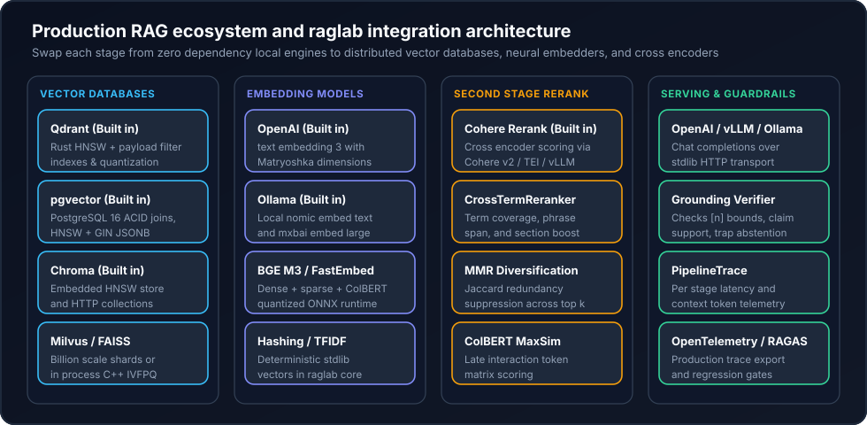
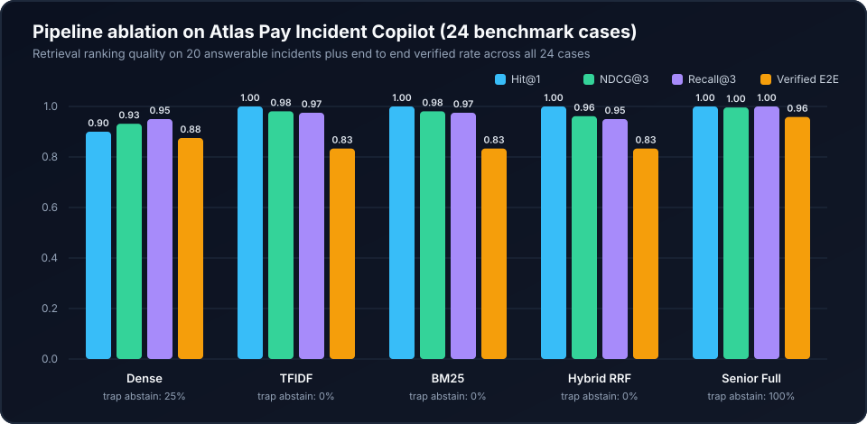
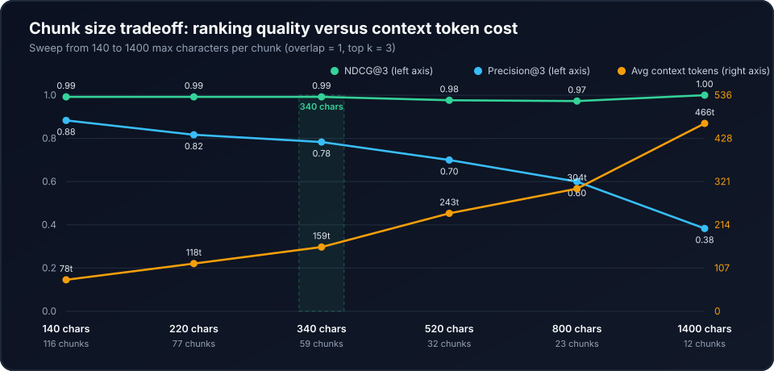
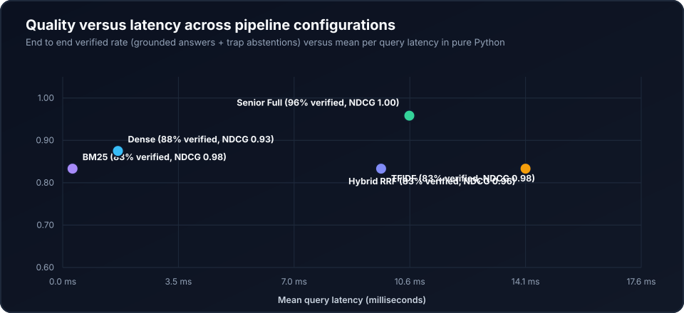

# raglab


`raglab` is a modular two stage Retrieval Augmented Generation (RAG) engine, ecosystem integration layer, and SRE benchmark suite in Python.

It pairs a transparent, zero dependency core engine with pluggable production connectors for **Qdrant**, **PostgreSQL (`pgvector`)**, **Chroma**, **OpenAI and Ollama neural embeddings**, **Cohere / vLLM / TEI cross encoder rerankers**, and **OpenAI compatible LLM servers**. Every stage of the RAG lifecycle is explicit, typed, instrumented with latency telemetry, and backed by reproducible ablation benchmarks.

Alongside the library, [projects/incident_copilot](projects/incident_copilot/README.md) implements a complete operational application on top of `raglab`: an on call SRE Incident Triage and Architecture Copilot for a payment platform (`Atlas Pay`), featuring runbooks, postmortems, architecture decision records, an autonomous question answering playbook, and multi stage evaluation.

## Contents

1. [Two stage RAG architecture](#1-two-stage-rag-architecture)
2. [Production ecosystem integrations (Qdrant, pgvector, Chroma, neural models)](#2-production-ecosystem-integrations)
3. [Empirical benchmarks and ablation charts](#3-empirical-benchmarks-and-ablation-charts)
4. [Flagship system: Atlas Pay Incident Copilot](#4-flagship-system-atlas-pay-incident-copilot)
5. [Quick start (In memory, Qdrant, and Docker stack)](#5-quick-start)
6. [Python API and pluggable connectors](#6-python-api-and-pluggable-connectors)
7. [Repository structure and documentation map](#7-repository-structure-and-documentation-map)
8. [Verification and engineering standards](#8-verification-and-engineering-standards)

## 1. Two stage RAG architecture


A production RAG system separates candidate recall from top k precision and treats generation as an untrusted consumer of cited passages. `raglab` executes indexing ahead of time and runs a structured query and verification funnel on every request.

| Stage | Responsibility | Core module |
| --- | --- | --- |
| 1. Document ingestion | Loads `.md` and `.txt` corpora and merges optional `metadata.json` facets (`kind`, `service`) | [documents.py](src/raglab/documents.py) |
| 2. Markdown chunking | Tracks ATX heading stacks into `metadata["section"]` breadcrumbs and keeps fenced SQL or code blocks atomic | [chunking.py](src/raglab/chunking.py) |
| 3. Vector & BM25 indexing | Builds L2 normalized dense vectors (`InMemoryVectorStore`, `QdrantVectorStore`, `PgVectorStore`, `ChromaVectorStore`) plus an Okapi `BM25Retriever` inverted index | [embeddings.py](src/raglab/embeddings.py), [vectorstore.py](src/raglab/vectorstore.py), [retrievers.py](src/raglab/retrievers.py) |
| 4. Prefiltered Hybrid RRF | Evaluates metadata predicates before top k truncation and fuses dense and lexical rankings via Reciprocal Rank Fusion | [retrievers.py](src/raglab/retrievers.py) |
| 5. Reranking & MMR | Rescores candidate pools with `CrossTermReranker` or `CohereCompatibleReranker`, then suppresses near duplicate siblings with `diversify_mmr` | [reranking.py](src/raglab/reranking.py), [rerankers.py](src/raglab/integrations/rerankers.py) |
| 6. Token budget packing | Packs ranked chunks greedily within `max_context_tokens` with numbered source and section headers | [prompting.py](src/raglab/prompting.py) |
| 7. Grounding verification | Audits `[n]` citation bounds, sentence level lexical attribution, and clean abstention on out of scope traps | [generation.py](src/raglab/generation.py), [verification.py](src/raglab/verification.py) |
| 8. Telemetry & metrics | Emits `PipelineTrace` per query and computes `Hit@k`, `MRR@k`, `NDCG@k`, `Recall@k`, `Precision@k`, and `EndToEndReport` | [pipeline.py](src/raglab/pipeline.py), [evaluation.py](src/raglab/evaluation.py) |

For full mathematical derivations of TFIDF, Okapi BM25 saturation, Reciprocal Rank Fusion, Maximal Marginal Relevance, and `NDCG@k`, see [docs/how_rag_works.md](docs/how_rag_works.md).

## 2. Production ecosystem integrations



`src/raglab/integrations` connects the core pipeline to industry standard vector databases, embedding servers, and neural rerankers through clean `VectorStore`, `Embedder`, and `Reranker` interfaces:

| Component | Integration class | Capabilities |
| --- | --- | --- |
| **Qdrant** | [QdrantVectorStore](src/raglab/integrations/qdrant.py) | Runs in memory (`:memory:`), embedded on disk, or against Qdrant Server / Cloud via `query_points`, deterministic UUID5 upserts, and native `Filter` + `FieldCondition` payload pushdown |
| **PostgreSQL + pgvector** | [PgVectorStore](src/raglab/integrations/pgvector.py) | Provisions `vector` extension, `HNSW` index (`vector_cosine_ops`), `GIN` JSONB index (`jsonb_path_ops`), `<=>` cosine search, and `@>` metadata prefiltering |
| **Chroma** | [ChromaVectorStore](src/raglab/integrations/chroma.py) | Supports `EphemeralClient`, `PersistentClient`, and `HttpClient` with cosine HNSW space and compound `$and` / `$eq` filters |
| **OpenAI / vLLM / LiteLLM Embeddings** | [OpenAIEmbedder](src/raglab/integrations/embeddings.py) | Calls `/v1/embeddings` (`text-embedding-3-small`, `text-embedding-3-large`, `BAAI/bge-m3`) with Matryoshka `dimensions` support |
| **Ollama Local Embeddings** | [OllamaEmbedder](src/raglab/integrations/embeddings.py) | Calls `/api/embed` for local `nomic-embed-text` and `mxbai-embed-large` models |
| **Cohere / TEI / vLLM Rerank** | [CohereCompatibleReranker](src/raglab/integrations/rerankers.py) | Calls `/rerank` cross encoder endpoints (`rerank-v3.5`, `bge-reranker-v2-m3`) over first stage candidate pools |
| **Docker Infrastructure** | [deploy/compose.yaml](deploy/compose.yaml) | Ready to run local stack with `qdrant/qdrant`, `pgvector/pgvector:pg16`, and `ollama/ollama` |

Read [docs/ecosystem_and_tools.md](docs/ecosystem_and_tools.md) for HNSW memory sizing formulas, quantization tradeoffs (`int8` vs binary), and guidance on choosing between Qdrant, `pgvector`, Chroma, Milvus, Weaviate, and FAISS.

## 3. Empirical benchmarks and ablation charts

Every chart below is rendered deterministically from [benchmark_results.json](projects/incident_copilot/benchmark_results.json) by `python scripts/generate_charts.py` and verified against drift in `pytest`.

### Pipeline stage ablation



| Configuration | Chunks | Hit@1 | MRR@3 | NDCG@3 | Multi doc NDCG@3 | Trap abstention | Verified E2E | Mean latency |
| --- | ---: | ---: | ---: | ---: | ---: | ---: | ---: | ---: |
| `dense` (128d unigram hash, unfiltered) | 66 | 0.90 | 0.95 | 0.93 | 0.67 | 0.25 | 0.88 | 4.0 ms |
| `tfidf` (unigram cosine, unfiltered) | 66 | 1.00 | 1.00 | 0.98 | 0.87 | 0.00 | 0.83 | 16.8 ms |
| `bm25` (lexical Okapi BM25, unfiltered) | 66 | 1.00 | 1.00 | 0.98 | 0.87 | 0.00 | 0.83 | 0.8 ms |
| `hybrid_rrf` (Dense + BM25 + metadata prefilter) | 66 | 1.00 | 1.00 | 0.96 | 0.74 | 0.00 | 0.83 | 24.1 ms |
| `senior_full` (Markdown + Hybrid RRF + Rerank + MMR + Guardrail) | 43 | 1.00 | 1.00 | 1.00 | 0.97 | 1.00 | 0.96 | 18.7 ms |

Key observations from the benchmark data:

1. **RRF without MMR degrades multi document questions (`0.74` vs `0.97` Multi doc `NDCG@3`).** When a question requires both a runbook and a postmortem, three sibling chunks from the longer document score high in both BM25 and Dense retrieval and fill all top 3 RRF slots. Applying `CrossTermReranker` and `diversify_mmr(lambda_weight=0.65)` suppresses redundant siblings and restores `Recall@3` to `1.00`.
2. **Unguarded generators fail out of scope traps (`0.00` to `0.25` abstention).** Four benchmark queries target unindexed infrastructure (`GraphQL federation timeouts`, `NVIDIA H100 nodes`, `Brazil SMS vendors`, `Snowflake archive tables`). Coverage gating plus `verify_answer` lifts trap abstention to `1.00` and end to end verified accuracy to `0.96`.
3. **Markdown aware chunking shrinks the index by 35 percent (`43` vs `66` chunks)** while keeping fenced SQL blocks intact and attaching section breadcrumbs.

### Chunk size versus token cost



Sweeping flat sentence `max_chars` from `140` to `1400` characters highlights why chunk sizing must balance retrieval precision against prompt budget:

* Below `220` characters, procedures split into `77` to `116` tiny fragments.
* Around `340` characters, `NDCG@3` holds at `0.99` with `Precision@3` at `0.78` and an average budget of `159` context tokens (`59` flat chunks, or `43` structural chunks under `markdown_aware=True`).
* At `1400` characters, whole documents become single chunks (`12` total). Fetching `top_k = 3` then injects two unrelated documents into every single document query, dropping `Precision@3` from `0.88` to `0.38` and pushing prompt cost to `466` tokens.

### Quality versus query latency



## 4. Flagship system: Atlas Pay Incident Copilot

Located in [projects/incident_copilot](projects/incident_copilot/README.md), `incident_copilot` indexes 12 SRE operational documents (`runbooks/`, `postmortems/`, `architecture/`) and executes an autonomous incident triage playbook that poses operational questions, filters by service and document kind, verifies citations, and refuses out of scope traps:

```bash
python projects/incident_copilot/run_playbook.py
```

```text
Atlas Pay Incident Copilot initialized (43 structural chunks)

[1] Question: Workers emit SQLSTATE 53300 on Postgres connections. What is the immediate PgBouncer mitigation?
    Scope: kind=runbook, service=postgres
    Answer: Checkout and ledger workers emit `SQLSTATE 53300` (`too many connections for role atlas_app`) and p99 write latency climbs past 1200 milliseconds. [1] Switch PgBouncer `pool_mode` to `transaction` on the affected pool and cap `default_pool_size` at 60 per primary core group so background workers cannot starve checkout writes. [2]
    Top citation: runbooks/postgres_pool_saturation.md (Postgres connection pool saturation > Symptoms and paging alerts)
    Verification: verified | tokens=180 | latency=15.48ms

[6] Question: How do we provision NVIDIA H100 GPU nodes for fraud model training?
    Scope: unfiltered
    Answer: I could not find an answer to that in the indexed documents.
    Verification: abstained (out of scope) | tokens=195 | latency=16.17ms
```

## 5. Quick start

Requires Python 3.10 or newer.

```bash
git clone https://github.com/gabrielcampeao/raglab.git
cd raglab
python -m venv .venv
```

Activate the virtual environment (`source .venv/bin/activate` on Linux and macOS, or `.venv\Scripts\activate` on Windows) and install with development and Qdrant extras:

```bash
pip install -e ".[dev,qdrant]"
```

Run a grounded query using the **Qdrant** backend right from the command line (uses embedded Qdrant by default, or pass `--qdrant-url http://localhost:6333` when running `deploy/compose.yaml`):

```bash
raglab ask "Workers emit SQLSTATE 53300 on Postgres connections. What is the immediate mitigation?" \
  --data projects/incident_copilot/corpus \
  --backend qdrant \
  --filter kind=runbook --filter service=postgres \
  --markdown --rerank --mmr 0.65 --max-tokens 260 \
  --show-trace
```

Benchmark all retrievers or spin up the full Docker infrastructure stack (`Qdrant` + `PostgreSQL 16 pgvector` + `Ollama`):

```bash
raglab evaluate --data projects/incident_copilot/corpus --cases projects/incident_copilot/benchmark.json --markdown --rerank --mmr 0.65
docker compose -f deploy/compose.yaml up -d
```

## 6. Python API and pluggable connectors

```python
from raglab import (
    BM25Retriever,
    CrossTermReranker,
    DenseRetriever,
    ExtractiveGenerator,
    HashingEmbedder,
    HybridRetriever,
    RAGPipeline,
)
from raglab.integrations import QdrantVectorStore

qdrant_store = QdrantVectorStore(collection_name="sre_docs", location=":memory:")
hybrid = HybridRetriever(
    retrievers=[
        DenseRetriever(HashingEmbedder(dimensions=512), qdrant_store),
        BM25Retriever(),
    ]
)

pipeline = RAGPipeline(
    retriever=hybrid,
    generator=ExtractiveGenerator(min_shared_terms=2, min_overlap_ratio=0.34),
    reranker=CrossTermReranker(),
    mmr_lambda=0.65,
    max_context_tokens=260,
    markdown_aware=True,
    max_chars=340,
)
pipeline.ingest_directory("projects/incident_copilot/corpus")

answer = pipeline.ask(
    "What burn rate threshold pages Sev1 immediately?",
    filters={"kind": "architecture"},
)
print(answer.text)
print(answer.grounding.is_verified, answer.trace.total_ms)
```

## 7. Repository structure and documentation map

```text
raglab/
├── src/raglab/
│   ├── models.py                Document, Chunk, and SearchResult dataclasses
│   ├── documents.py             Directory loader with metadata.json manifest support
│   ├── chunking.py              Sentence and ATX Markdown structure aware chunkers
│   ├── embeddings.py            HashingEmbedder and TfidfEmbedder
│   ├── vectorstore.py           VectorStore interface and InMemoryVectorStore
│   ├── retrievers.py            DenseRetriever, BM25Retriever, and HybridRetriever (RRF)
│   ├── reranking.py             CrossTermReranker and Maximal Marginal Relevance (MMR)
│   ├── prompting.py             Token estimator, budget packer, and prompt formatter
│   ├── generation.py            ExtractiveGenerator and OpenAICompatibleGenerator
│   ├── verification.py          Citation bounds, claim attribution, and abstention verifier
│   ├── evaluation.py            Hit@k, MRR, NDCG@k, Precision@k, and EndToEndReport
│   ├── pipeline.py              Instrumented RAGPipeline with PipelineTrace
│   ├── cli.py                   Command line interface (ask, search, evaluate)
│   └── integrations/            Qdrant, pgvector, Chroma, OpenAI/Ollama embedders, Cohere rerank
├── projects/incident_copilot/   Flagship SRE triage copilot, 12 doc corpus, 24 case benchmark
├── examples/                    Six progressive runnable scripts (01_quickstart to 06_qdrant_hybrid)
├── deploy/compose.yaml          Local Docker stack (Qdrant + PostgreSQL pgvector + Ollama)
├── docs/
│   ├── assets/                  Five deterministic SVG architecture and benchmark charts
│   ├── how_rag_works.md         Mathematical derivations and failure mode diagnostics
│   ├── ecosystem_and_tools.md   Deep dive into Qdrant, pgvector, Chroma, Milvus, FAISS, and rerankers
│   ├── use_cases.md             Domain configurations and RAG anti patterns
│   ├── architecture_spec.md     System specification and self answered architectural Q and A
│   └── design_notes.md          Core tradeoffs and design constraints
├── scripts/                     Commit validator and pure Python SVG chart generator
└── tests/                       Full unit, integration, Qdrant, CLI, copilot, and SVG test suite
```

## 8. Verification and engineering standards

```bash
ruff format --check .
ruff check .
pytest --cov
python scripts/generate_charts.py
```

* Strict modular boundaries and complete static type annotations with zero inline comments or docstrings in Python code.
* Real `QdrantVectorStore` execution verified in CI across Python 3.10, 3.11, 3.12, and 3.13 alongside `PgVectorStore`, `ChromaVectorStore`, neural embedders, and chart synchronization tests.
* Conventional Commit workflow enforced via `.githooks/commit-msg`. See [CONTRIBUTING.md](CONTRIBUTING.md) and [CHANGELOG.md](CHANGELOG.md).
