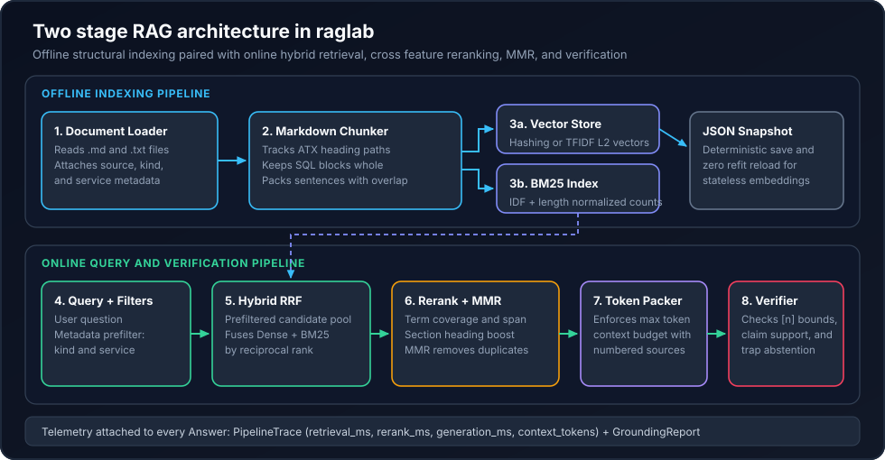

# raglab


`raglab` is a zero dependency two stage Retrieval Augmented Generation (RAG) engine, verification layer, and benchmark suite written in pure Python.

Most RAG repositories wire together heavyweight wrapper libraries where chunk boundaries, ranking math, context budgets, and citation checks disappear behind opaque abstractions. `raglab` implements the full retrieval and verification stack directly on the Python standard library so every stage can be inspected, profiled, swapped, and tested deterministically in milliseconds.

Alongside the core library, [projects/incident_copilot](projects/incident_copilot/README.md) ships a complete production style application built on `raglab`: an on call SRE Incident Triage and Architecture Copilot for a payment platform (`Atlas Pay`), complete with runbooks, postmortems, architecture records, an autonomous question answering playbook, and reproducible ablation benchmarks.



## Architecture overview

A reliable RAG system separates recall from precision and treats generation as an untrusted consumer of retrieved evidence. `raglab` splits execution into an offline structural indexing phase and a five step online query and verification pipeline.

| Stage | Responsibility | Implementation |
| --- | --- | --- |
| Structural chunking | Parses Markdown ATX heading hierarchies into `metadata["section"]` breadcrumbs and preserves fenced SQL or shell blocks intact within `max_chars` | [chunking.py](src/raglab/chunking.py) |
| Dense and lexical indexing | Builds stateless `HashingEmbedder` or corpus fitted `TfidfEmbedder` L2 unit vectors alongside an inverted `BM25Retriever` index | [embeddings.py](src/raglab/embeddings.py), [vectorstore.py](src/raglab/vectorstore.py), [retrievers.py](src/raglab/retrievers.py) |
| Prefiltered Hybrid RRF | Applies exact metadata predicates (`kind`, `service`) before top k truncation and fuses dense cosine rankings with BM25 via Reciprocal Rank Fusion | [retrievers.py](src/raglab/retrievers.py) |
| Cross feature reranking and MMR | Rescores candidate pools on distinct query term coverage, ordered bigram proximity, and section heading overlap, then applies Maximal Marginal Relevance (`diversify_mmr`) to eliminate sibling duplicates | [reranking.py](src/raglab/reranking.py) |
| Token budget context packing | Packs ranked chunks up to `max_context_tokens` with numbered source and section headers | [prompting.py](src/raglab/prompting.py) |
| Generation and grounding verification | Produces cited answers offline (`ExtractiveGenerator`) or over any OpenAI compatible endpoint (`OpenAICompatibleGenerator`), then audits `[n]` citation bounds, sentence support, and trap abstention (`verify_answer`) | [generation.py](src/raglab/generation.py), [verification.py](src/raglab/verification.py) |
| Telemetry and evaluation | Attaches `PipelineTrace` (`retrieval_ms`, `rerank_ms`, `generation_ms`, `context_tokens`) to every `Answer` and scores `Hit@k`, `MRR@k`, `NDCG@k`, `Recall@k`, `Precision@k`, and `EndToEndReport` | [pipeline.py](src/raglab/pipeline.py), [evaluation.py](src/raglab/evaluation.py) |

For the mathematical derivations behind TFIDF, Okapi BM25 saturation, Reciprocal Rank Fusion, MMR, and `NDCG@k`, read [docs/how_rag_works.md](docs/how_rag_works.md).

## Empirical evaluation and charts

All charts below are generated directly from [benchmark_results.json](projects/incident_copilot/benchmark_results.json) by running `python scripts/generate_charts.py` against the 12 document, 24 query `Atlas Pay` SRE benchmark.

### Pipeline ablation


| Configuration | Chunks | Hit@1 | MRR@3 | NDCG@3 | Multi doc NDCG@3 | Trap abstention | Verified E2E | Mean latency |
| --- | ---: | ---: | ---: | ---: | ---: | ---: | ---: | ---: |
| `dense` (128d unigram hash, unfiltered) | 66 | 0.90 | 0.95 | 0.93 | 0.67 | 0.25 | 0.88 | 4.0 ms |
| `tfidf` (unigram cosine, unfiltered) | 66 | 1.00 | 1.00 | 0.98 | 0.87 | 0.00 | 0.83 | 16.8 ms |
| `bm25` (lexical Okapi BM25, unfiltered) | 66 | 1.00 | 1.00 | 0.98 | 0.87 | 0.00 | 0.83 | 0.8 ms |
| `hybrid_rrf` (Dense + BM25 + metadata prefilter) | 66 | 1.00 | 1.00 | 0.96 | 0.74 | 0.00 | 0.83 | 24.1 ms |
| `senior_full` (Markdown + Hybrid RRF + Rerank + MMR + Guardrail) | 43 | 1.00 | 1.00 | 1.00 | 0.97 | 1.00 | 0.96 | 18.7 ms |

Three findings stand out in the ablation data:

1. **RRF without diversification hurts multi document synthesis (`0.74` vs `0.97` Multi doc `NDCG@3`).** When a question spans both a runbook and a postmortem, chunks from the longer document score well in both BM25 and Dense search. RRF promotes three sibling chunks from that single document into the top 3 slots, crowding out the second required source. Adding `CrossTermReranker` plus `diversify_mmr(lambda_weight=0.65)` suppresses redundant siblings and lifts `Recall@3` to `1.00` and Multi doc `NDCG@3` to `0.97`.
2. **Unconstrained extraction fails on out of scope traps (`0.00` to `0.25` abstention).** Four benchmark queries ask about infrastructure absent from the corpus (`GraphQL federation timeouts`, `NVIDIA H100 nodes`, `Brazil SMS vendors`, `Snowflake archive tables`). Naive sentence matching latches onto shared generic words such as `timeout`, `table`, or `policy` and returns misleading citations. Enforcing query coverage thresholds alongside `verify_answer` raises trap abstention to `1.00` and overall end to end verified accuracy to `0.96` (23 of 24 cases).
3. **Markdown aware chunking cuts index size by 35 percent (`43` vs `66` chunks)** while keeping SQL diagnostic queries intact and preserving section paths for reranking.

### Chunk size tradeoff


Sweeping flat sentence `max_chars` from `140` to `1400` characters exposes the tension between context precision and prompt cost:

* Below `220` characters, chunks fragment individual runbook procedures across boundaries (`77` to `116` chunks).
* Around `340` characters, `NDCG@3` holds at `0.99` with `Precision@3` at `0.78` while consuming an average of `159` context tokens per query (`59` flat chunks, or `43` chunks once `markdown_aware=True` aligns splits with headings).
* At `1400` characters, each document collapses into a single chunk (`12` chunks total). With `top_k = 3`, every single document question pulls two unrelated full documents into the prompt, dropping `Precision@3` from `0.88` to `0.38` and nearly tripling prompt cost to `466` tokens.

### Quality versus latency


Pure lexical `BM25` resolves queries in `0.8 ms`, making it a strong first stage filter, while the full two stage pipeline (`senior_full`) completes hybrid retrieval, cross term reranking over 16 candidates, MMR selection, context packing, extraction, and citation verification in `18.7 ms` per query in pure Python without C extensions.

## Flagship application: Atlas Pay Incident Copilot

Inside [projects/incident_copilot](projects/incident_copilot/README.md), `raglab` powers an autonomous SRE triage and architecture review engine over 12 operational documents (`runbooks/`, `postmortems/`, `architecture/`).

Run the self answering incident playbook and live ablation benchmark with one command:

```bash
python projects/incident_copilot/run_playbook.py
```

```text
Atlas Pay Incident Copilot initialized (43 structural chunks)

Autonomous incident triage and architecture review
==================================================

[1] Question: Workers emit SQLSTATE 53300 on Postgres connections. What is the immediate PgBouncer mitigation?
    Scope: kind=runbook, service=postgres
    Answer: Checkout and ledger workers emit `SQLSTATE 53300` (`too many connections for role atlas_app`) and p99 write latency climbs past 1200 milliseconds. [1] Switch PgBouncer `pool_mode` to `transaction` on the affected pool and cap `default_pool_size` at 60 per primary core group so background workers cannot starve checkout writes. [2]
    Top citation: runbooks/postgres_pool_saturation.md (Postgres connection pool saturation > Symptoms and paging alerts)
    Verification: verified | tokens=180 | latency=15.48ms

[6] Question: How do we provision NVIDIA H100 GPU nodes for fraud model training?
    Scope: unfiltered
    Answer: I could not find an answer to that in the indexed documents.
    Verification: abstained (out of scope) | tokens=195 | latency=16.17ms
```

## Quick start

Requires Python 3.10 or newer.

```bash
git clone https://github.com/gabrielcampeao/raglab.git
cd raglab
python -m venv .venv
```

Activate the virtual environment (`source .venv/bin/activate` on Linux and macOS, or `.venv\Scripts\activate` on Windows) and install in editable mode:

```bash
pip install -e ".[dev]"
```

Query the SRE corpus from the CLI with structural Markdown chunking, second stage reranking, MMR diversification, metadata prefiltering, token budgeting, and latency tracing:

```bash
raglab ask "Workers emit SQLSTATE 53300 on Postgres connections. What is the immediate mitigation?" \
  --data projects/incident_copilot/corpus \
  --markdown --rerank --mmr 0.65 --max-tokens 260 \
  --show-trace
```

Inspect raw candidate rankings or evaluate all retrievers on any labeled JSON benchmark:

```bash
raglab search "CREATE INDEX CONCURRENTLY lock_timeout" --data projects/incident_copilot/corpus --markdown --rerank
raglab evaluate --data projects/incident_copilot/corpus --cases projects/incident_copilot/benchmark.json --markdown --rerank
```

## Python API

```python
from raglab import (
    CrossTermReranker,
    ExtractiveGenerator,
    HybridRetriever,
    RAGPipeline,
)

pipeline = RAGPipeline(
    retriever=HybridRetriever(),
    generator=ExtractiveGenerator(min_shared_terms=2, min_overlap_ratio=0.34),
    reranker=CrossTermReranker(),
    candidate_pool=16,
    mmr_lambda=0.65,
    max_context_tokens=260,
    markdown_aware=True,
    max_chars=340,
    overlap=1,
    top_k=3,
)
pipeline.ingest_directory("projects/incident_copilot/corpus")

answer = pipeline.ask(
    "What burn rate threshold pages Sev1 immediately?",
    filters={"source": "architecture/slo_and_burn_rates.md"},
)
print(answer.text)
print(answer.grounding.is_verified, answer.trace.total_ms)
```

### Connecting OpenAI, Ollama, or vLLM

Swap `ExtractiveGenerator` for `OpenAICompatibleGenerator` to synthesize answers over any OpenAI chat completions endpoint using only `urllib.request`:

```bash
export OPENAI_API_KEY=your_key
raglab ask "Why were mobile shoppers charged twice in April?" \
  --data projects/incident_copilot/corpus \
  --markdown --rerank --mmr 0.65 \
  --generator openai --model gpt-4o-mini
```

Against a local [Ollama](https://ollama.com) server:

```bash
raglab ask "How do we isolate a degraded webhook endpoint?" \
  --data projects/incident_copilot/corpus \
  --markdown --rerank \
  --generator openai --model llama3.2 --base-url http://localhost:11434/v1
```

## Progressive examples and documentation

| Path | Focus |
| --- | --- |
| [projects/incident_copilot](projects/incident_copilot/README.md) | Full SRE Incident Copilot corpus, 24 case benchmark, autonomous playbook, and ablation runner |
| [examples/01_quickstart.py](examples/01_quickstart.py) | Minimal ingestion, grounded Q and A, and unanswerable refusal on a help center corpus |
| [examples/02_inspect_pipeline.py](examples/02_inspect_pipeline.py) | Step by step inspection of documents, chunks, RRF scores, prompt text, and citations |
| [examples/03_compare_retrievers.py](examples/03_compare_retrievers.py) | Side by side `Hit@k`, `MRR`, and `Recall` comparison across retrievers |
| [examples/04_persist_index.py](examples/04_persist_index.py) | Saving and reloading a stateless `HashingEmbedder` vector index to JSON |
| [examples/05_llm_generation.py](examples/05_llm_generation.py) | Wiring `OpenAICompatibleGenerator` to OpenAI or local inference servers |
| [docs/how_rag_works.md](docs/how_rag_works.md) | Deep dive into chunking, vector geometry, BM25, RRF, cross feature reranking, MMR, and verification math |
| [docs/use_cases.md](docs/use_cases.md) | Production RAG patterns, recommended parameter regimes, and architectural anti patterns |
| [docs/architecture_spec.md](docs/architecture_spec.md) | System specification and self answered architectural design review |

## Repository layout

```text
raglab/
├── src/raglab/                  core engine: chunking, embeddings, retrievers, reranking, verification, cli
├── projects/incident_copilot/   flagship SRE triage copilot, 12 doc corpus, 24 case benchmark, playbook
├── examples/                    focused scripts demonstrating individual API capabilities
├── docs/                        technical guides, architecture spec, and generated SVG charts
├── scripts/                     commit message validator and deterministic SVG chart generator
└── tests/                       191 unit, integration, example, copilot, and chart verification tests
```

## Verification and engineering standards

```bash
ruff check .
ruff format --check .
pytest --cov
python scripts/generate_charts.py
```

* Zero runtime dependencies (`dependencies = []`).
* Self documenting code with strict type annotations and zero inline comments or docstrings across all Python modules.
* Automated chart integrity tests verifying that every SVG in `docs/assets/` parses as valid XML and matches the benchmark suite.
* Conventional Commit history enforced by `.githooks/commit-msg` and validated across Python 3.10, 3.11, 3.12, and 3.13 in GitHub Actions. See [CONTRIBUTING.md](CONTRIBUTING.md).

## Known boundaries

* `HashingEmbedder` and `TfidfEmbedder` operate on lexical tokens and word pairs. Plugging in dense neural embeddings requires subclassing `Embedder.embed` (roughly 15 lines of code).
* `InMemoryVectorStore` runs exact linear cosine scans for lightweight single process workloads, while `QdrantVectorStore`, `PgVectorStore`, and `ChromaVectorStore` scale to HNSW indexed vector collections.
