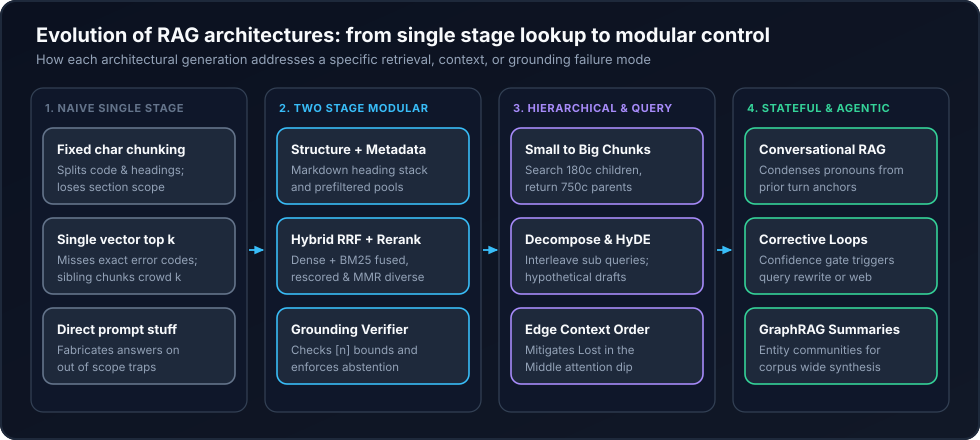

# Advanced RAG architectures and research patterns

Single stage vector lookup works on clean textbook paragraphs and breaks as soon as users ask multi part questions, follow up with pronouns, query terse error codes, or need full surrounding procedures rather than isolated sentences. This study examines the advanced patterns implemented in `raglab` alongside adjacent paradigms from recent information retrieval research.



## 1. Small to big (`ParentChildRetriever`)

Chunk sizing in standard RAG forces an uncomfortable compromise: small chunks (`150` to `200` characters) score sharply because a single relevant sentence is not diluted by ten surrounding sentences, yet handing a `160` character fragment to a language model strips away preconditions, SQL queries, and rollback warnings.

`ParentChildRetriever` in [parent_child.py](../src/raglab/parent_child.py) decouples **search granularity** from **generation granularity**:

1. `build_parent_child_chunks` splits each document into broad parent sections (`parent_max_chars = 750`, respecting ATX Markdown headings and atomic code blocks).
2. Each parent is subdivided into compact child chunks (`child_max_chars = 180`) carrying `metadata["parent_id"]`.
3. Only the **child chunks** enter the dense and BM25 indexes.
4. At query time, `ParentChildRetriever` fetches a wider pool of child hits, groups them by `parent_id` keeping the maximum child score per parent, and returns the deduplicated **parent sections** to the prompt builder.

```python
from raglab import HybridRetriever, ParentChildRetriever, RAGPipeline

retriever = ParentChildRetriever(
    HybridRetriever(),
    parent_max_chars=750,
    child_max_chars=180,
    markdown_aware=True,
)
pipeline = RAGPipeline(retriever=retriever, max_chars=750, markdown_aware=True)
```

## 2. Query transformations: expansion, decomposition, and HyDE

User queries are poor search probes for three distinct reasons, each requiring a different transformation in [query.py](../src/raglab/query.py).

### Acronym expansion (`AcronymQueryExpander` + RRF)

When an on call engineer types `"pods hitting oom"`, documents written with `"exit code 137"` or `"out of memory"` may rank lower on unigram overlap. `AcronymQueryExpander` emits multiple phrasings of the **same** intent, and `MultiQueryRetriever(..., fusion="rrf")` sums `1 / (rrf_k + rank)` across variants so passages matching both phrasings rise to rank 1.

### Sub question decomposition (`SubQuestionDecomposer` + round robin interleaving)

Consider a compound question spanning two subsystems:

```text
How do we stop Redis hot key stampedes and how do we isolate degraded webhook endpoints?
```

Summing RRF scores across orthogonal sub questions introduces a subtle mathematical bug: a generic architecture document that ranks `#5` on both halves earns `1/65 + 1/65 = 0.0308`, beating the `#1` Redis runbook (`1/61 + 0 = 0.0164`) that appears in only one half.

When `MultiQueryRetriever` pairs with `SubQuestionDecomposer`, it switches to **`fusion="interleave"`**: round robin selection picks rank 1 from sub question 1 (`redis_cache_stampede.md`), rank 1 from sub question 2 (`payment_webhook_backlog.md`), rank 2 from sub question 1, and so on, guaranteeing every clause of a compound question receives prompt representation.

### Hypothetical Document Embeddings (`HyDERetriever`)

Introduced by Gao et al. (ACL 2023), **HyDE** addresses the geometric gap between short interrogative questions (`"prevent thundering herd on expired keys"`) and declarative runbook sentences (`"Enable singleflight request coalescing..."`). `HyDERetriever` calls a `hypothesis_builder` function (or a fast language model) to draft a plausible declarative answer passage, retrieves candidates for both the raw question and the hypothetical passage, and fuses the rankings via RRF. Even when the draft contains minor factual inaccuracies, its declarative vocabulary aligns far closer to real runbook prose in embedding space than the bare question.

## 3. Contextual chunk headers

A sentence such as `"Keys are retained for 24 hours and return HTTP 422 on payload mismatch"` contains no mention of `Atlas Pay` or `idempotency`. Anthropic's *Contextual Retrieval* study showed that prepending document and section context before embedding and BM25 indexing cuts top 20 retrieval failure rates substantially.

`raglab` implements deterministic structural contextualization out of the box: `chunk_markdown_documents` records the full heading ancestry (`Architecture record: double entry ledger > Idempotency contract`) in `metadata["section"]`, and both `DenseRetriever` and `BM25Retriever` index `f"{section}\n{chunk.text}"` automatically without polluting the raw passage text.

## 4. Mitigating the Lost in the Middle attention dip

Liu et al. (*Lost in the Middle: How Language Models Use Long Contexts*, TACL 2024) demonstrated that language models recall facts placed at the **very beginning** (primacy) or **very end** (recency) of the prompt context significantly better than facts buried in the middle slots.

Passing `reorder_context=True` to `RAGPipeline` invokes `reorder_lost_in_middle` in [prompting.py](../src/raglab/prompting.py):

* Rank 1 goes to position `1` (top of the context block).
* Rank 2 goes to position `k` (immediately above `Question:`).
* Rank 3 goes to position `2`, rank 4 to position `k - 1`, placing the weakest supporting chunks in the middle trough.

## 5. Multi turn conversational coreference (`ConversationalRAG`)

In multi turn troubleshooting, users rarely repeat the subject noun:

* **Turn 1:** `"Workers emit SQLSTATE 53300 on Postgres connections. What is the immediate mitigation?"`
* **Turn 2:** `"When do we escalate it to the database reliability lead?"`

Sent raw to a stateless retriever, Turn 2 contains no mention of `Postgres` or `pool saturation` and can match escalation sections from unrelated services. `ConversationalRAG` in [conversation.py](../src/raglab/conversation.py) detects anaphoric pronouns (`it`, `that`, `they`, `those`) and terse follow ups, extracts the primary section anchor from the prior turn (`Postgres connection pool saturation`), and retrieves with the anchored standalone query while preserving the user's original question on the returned `Answer`.

## 6. Corrective RAG, Self RAG, and Entity GraphRAG

When single pass retrieval fails due to terse acronyms, overly narrow metadata filters, or disconnected evidence split across multiple files, three higher order patterns close the gap:

* **Corrective RAG (`CorrectiveRAG` in [corrective.py](../src/raglab/corrective.py)):** Implements the confidence gated control loop of Yan et al. (2024) directly over `RAGPipeline`. After each pass, `CorrectiveRAG` checks `top_score >= min_top_score`, `grounded_ratio >= min_grounded_ratio`, and `answer.grounding.is_verified`. When the first pass fails, it rewrites the query through `QueryExpander` (`decision="rewritten"`), relaxes restrictive metadata filters when permitted (`decision="relaxed_filters"`), or returns a clean verified abstention (`decision="abstained"`) with every attempt recorded in `CorrectiveOutcome.steps`.
* **Entity GraphRAG (`EntityGraphRetriever` in [graph.py](../src/raglab/graph.py)):** Extracts operational entities (backtick identifiers, dotted config keys, error codes such as `SQLSTATE 53300`, acronyms, and service names) into an undirected weighted co occurrence `KnowledgeGraph`. At query time, seed entities propagate decaying activation energy across `hops` graph steps (`decay=0.45`) weighted by entity IDF, surfacing linked documents across multiple hops even when they share zero lexical tokens with the initial query. Full corpus wide synthesis extends this structure with hierarchical Leiden community summaries (Edge et al., 2024).
* **Self RAG (Asai et al., 2023):** Trains or prompts the generator to emit explicit reflection decisions (whether retrieval is needed, whether each retrieved chunk supports the claim, and whether the final answer addresses the prompt). `verify_answer` provides a fast deterministic counterpart with zero extra model calls.

```python
from raglab import (
    AcronymQueryExpander,
    CorrectiveRAG,
    CrossTermReranker,
    DenseRetriever,
    EntityGraphRetriever,
    HashingEmbedder,
    HNSWVectorStore,
    RAGPipeline,
)

pipeline = RAGPipeline(
    retriever=DenseRetriever(HashingEmbedder(dimensions=256), HNSWVectorStore()),
    reranker=CrossTermReranker(),
    markdown_aware=True,
    max_chars=340,
)
pipeline.ingest_directory("projects/incident_copilot/corpus")

crag = CorrectiveRAG(
    pipeline,
    expander=AcronymQueryExpander({"oom": "OOMKilled exit code 137 memory limits"}),
    min_top_score=0.30,
)
outcome = crag.ask("Why do checkout pods hit OOM?")
print(outcome.decision, [step.action for step in outcome.steps])

graph_pipeline = RAGPipeline(retriever=EntityGraphRetriever(hops=2, decay=0.45))
graph_pipeline.ingest_directory("projects/incident_copilot/corpus")
hits = graph_pipeline.retrieve("SQLSTATE 53300", k=3)
```

## Primary research references

* Luyu Gao, Xueguang Ma, Jimmy Lin, and Jamie Callan, 2023, *Precise Zero Shot Dense Retrieval without Relevance Labels (HyDE)*, ACL.
* Nelson F. Liu et al., 2024, *Lost in the Middle: How Language Models Use Long Contexts*, Transactions of the Association for Computational Linguistics.
* Akari Asai, Zeqiu Wu, Yizhong Wang, Avirup Sil, and Hannaneh Hajishirzi, 2023, *Self RAG: Learning to Retrieve, Generate, and Critique through Self Reflection*, ICLR.
* Shi Qi Yan, Jia Chen Gu, Yun Zhu, and Zhen Hua Ling, 2024, *Corrective Retrieval Augmented Generation*, arXiv.
* Darren Edge et al., 2024, *From Local to Global: A Graph RAG Approach to Query Focused Summarization*, Microsoft Research.
