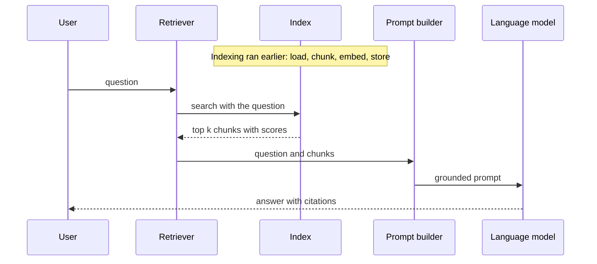

# How RAG works

This guide walks through Retrieval Augmented Generation one stage at a time and points to the module in `src/raglab` that implements each stage. Reading the guide next to the code is the fastest way to build an intuition for it.

## The problem

A large language model writes text by predicting the next token from patterns it learned during training. That gives it broad general knowledge, with three limits that matter in practice:

1. It knows nothing about documents it never saw, such as your internal wiki or a policy written last month.
2. Its knowledge stops at the training cutoff.
3. When it lacks a fact, it often produces a fluent guess instead of admitting the gap.

Fine tuning can teach a model new style or behavior, but it is a poor way to store facts that change. Retrieval Augmented Generation takes a different route: keep the facts in documents, find the relevant ones at question time, and hand them to the model inside the prompt.

## Two phases

A RAG system does its work in two phases. Indexing happens ahead of time, whenever documents change. Answering happens on every question.



## Indexing

### Loading

[documents.py](../src/raglab/documents.py) walks a folder and turns every Markdown or text file into a `Document` with an id and a `source` field. Real systems also parse PDFs, HTML, tickets or database rows, but whatever the input, the output is the same: plain text plus metadata saying where it came from. That metadata is what later lets an answer cite its sources.

### Chunking

Documents are usually too long to paste whole into a prompt, and a long document often covers several topics. Retrieval works better on smaller pieces, so [chunking.py](../src/raglab/chunking.py) splits each document into chunks.

The chunker splits on sentence boundaries and packs sentences into chunks of at most `max_chars` characters. With `overlap=1`, the last sentence of one chunk is repeated at the start of the next, so a fact that sits on a boundary still appears whole in at least one chunk.

Chunk size is a tradeoff:

* Small chunks are precise, but a single chunk may lack the surrounding context needed to answer.
* Large chunks carry more context, but they dilute the match score and use more of the prompt budget.

A few hundred to a thousand characters is a common starting point. The sample data uses 500.

### Embedding

To search by meaning, each chunk becomes a vector: a list of numbers where similar texts land close together. [embeddings.py](../src/raglab/embeddings.py) offers two embedders that need no model download.

`HashingEmbedder` tokenizes the text, adds word pairs (bigrams), and hashes each feature into one of 1024 slots. It has no vocabulary and no training step, so it can embed any text at any time and the resulting index can be saved and reloaded without refitting.

`TfidfEmbedder` learns a vocabulary from the corpus and weights each term by how rare it is. A word that appears in every chunk tells you little, so it gets a low weight. The weight for a term is:

```text
idf(term) = ln((1 + N) / (1 + df(term))) + 1
```

where `N` is the number of chunks and `df(term)` is how many chunks contain the term.

Both produce sparse, word based vectors. Production systems use neural embedding models, which map "refund" and "money back" to nearby vectors even though they share no words. The interface stays the same: implement `Embedder.embed` and the rest of raglab works unchanged.

### Storing

[vectorstore.py](../src/raglab/vectorstore.py) keeps chunks and vectors side by side in memory. Search computes the cosine similarity between the query vector and every stored vector:

```text
cosine(a, b) = (a . b) / (|a| * |b|)
```

A score of 1 means the vectors point the same way. A score of 0 means they share nothing. Comparing against every vector is fine for thousands of chunks. Vector databases such as FAISS, pgvector or Qdrant use approximate nearest neighbor indexes to do the same job over millions.

## Answering

### Retrieval

[retrievers.py](../src/raglab/retrievers.py) has three strategies.

Dense retrieval embeds the question with the same embedder used for the chunks and returns the closest vectors.

BM25 is the classic keyword ranking function behind many search engines. It rewards chunks that contain the query terms, gives rare terms more weight, and stops rewarding repeated terms after a point so a chunk cannot win by repeating one word:

```text
score(chunk) = sum over query terms t of
    idf(t) * f(t) * (k1 + 1) / (f(t) + k1 * (1 - b + b * length / average_length))
```

`f(t)` is how often the term appears in the chunk. `k1` controls how quickly repeated terms stop adding score, and `b` controls how much long chunks are penalized.

Hybrid retrieval runs both and merges the rankings with Reciprocal Rank Fusion:

```text
fused(chunk) = sum over retrievers of 1 / (rrf_k + rank)
```

RRF only looks at positions, not raw scores, so it can combine cosine similarities and BM25 scores that live on completely different scales. Keyword search catches exact names, codes and numbers. Semantic search catches paraphrases. Together they miss less than either one alone, which is why hybrid search is the default in raglab.

### Augmentation

[prompting.py](../src/raglab/prompting.py) assembles the prompt. Each retrieved chunk gets a number and its source, followed by the question and three rules: use only the context, say "I don't know" when the context is not enough, and cite sources by number. Run `raglab ask ... --show-prompt` to see the exact text a model would receive.

Those rules carry most of the weight in reducing made up answers. The model is no longer asked "what do you know about refunds?" but "according to these passages, what is the refund window?"

### Generation

[generation.py](../src/raglab/generation.py) has two generators.

`ExtractiveGenerator` runs offline. It scores every sentence in the retrieved chunks by how many question terms it shares and returns the best ones with their citation numbers. It cannot rephrase or reason, but it makes the retrieval step visible: if the right chunk was retrieved, the answer is there.

`OpenAICompatibleGenerator` sends the prompt to any server that speaks the OpenAI chat completions protocol. That includes OpenAI itself and local servers such as Ollama, LM Studio and vLLM. This is where a real model reads the context and writes a fluent answer.

## Evaluating retrieval

If the retriever does not find the right chunk, no model can produce the right answer. That makes retrieval the first thing to measure. [evaluation.py](../src/raglab/evaluation.py) takes a list of questions labeled with the documents that answer them and reports:

* Hit rate at k: the share of questions where at least one relevant chunk is in the top k.
* MRR (mean reciprocal rank): the average of `1 / rank` of the first relevant chunk. It rewards putting the right chunk first.
* Recall at k: the share of all relevant documents that appear in the top k.

Run `examples/03_compare_retrievers.py` or `raglab evaluate` to compare the four retrievers on the sample questions. Some of those questions are worded differently from the documents ("money back" instead of "refund"). On this small corpus the hashing based dense retriever puts the right chunk first for 10 of the 12 questions, while TFIDF, BM25 and hybrid get all 12. A perfect score on twelve questions says little about a real corpus, so treat the numbers as a demonstration of the method and grow the question set along with your documents.

## Common failure modes

| Symptom | Likely cause | What to try |
| --- | --- | --- |
| The answer ignores an obvious document | The chunk was never retrieved | Check with `raglab search`, try hybrid retrieval, add synonyms to the query |
| The answer is half right | The fact was split across chunks | Increase `max_chars` or `overlap` |
| The model invents details | Weak grounding instructions or irrelevant context | Tighten the template, lower `k`, filter by score |
| Exact codes or names are missed | Pure semantic search | Add BM25 through hybrid retrieval |
| Paraphrased questions fail | Pure keyword search | Use a neural embedding model |

## Further reading

* Lewis et al., 2020, "Retrieval Augmented Generation for Knowledge Intensive NLP Tasks", the paper that named the technique.
* Robertson and Zaragoza, 2009, "The Probabilistic Relevance Framework: BM25 and Beyond".
* Cormack, Clarke and Buettcher, 2009, "Reciprocal Rank Fusion outperforms Condorcet and individual Rank Learning Methods".
