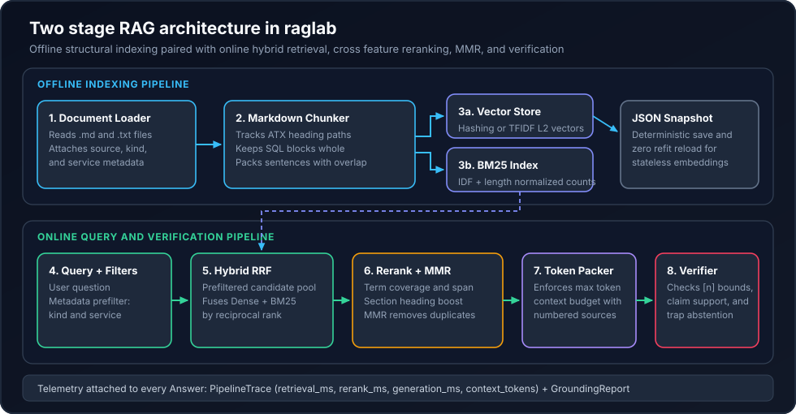
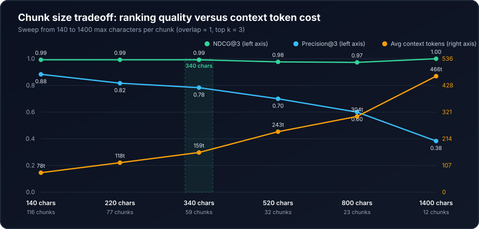
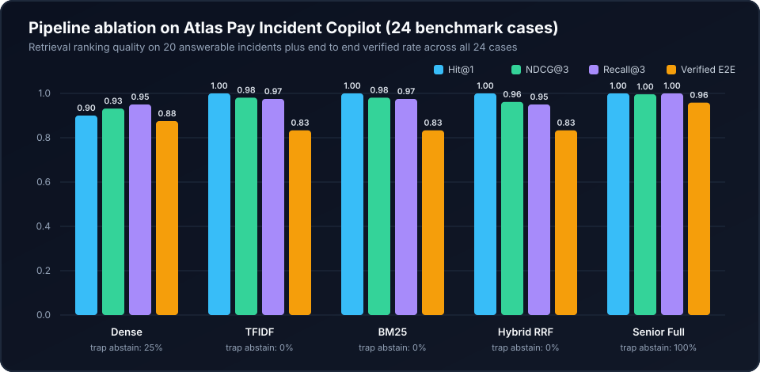
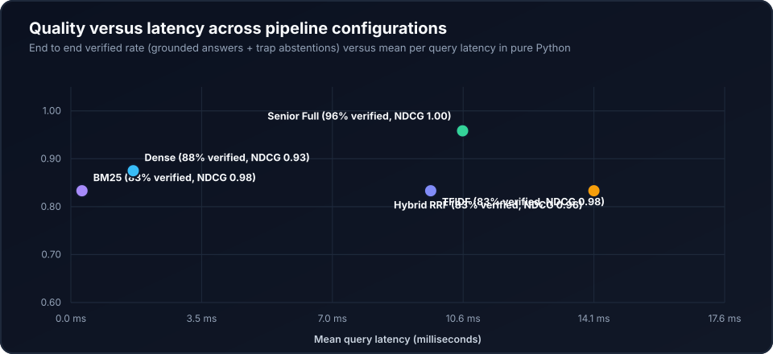

# How RAG works: algorithms, geometry, and failure modes

This guide traces a query through every stage of `raglab`, states the exact formulas used in `src/raglab`, and explains why naive single stage pipelines break on operational corpora.



## Why language models fail on private operational knowledge

Autoregressive language models compress statistical regularities from their training corpus into model weights. That mechanism has three structural blind spots in engineering environments:

1. **Private state:** Model weights never saw internal runbooks, postmortems, architecture records, or tenant contracts.
2. **Temporal drift:** Operational thresholds, on call escalation paths, and schema policies change weekly; retraining or fine tuning weights to track mutable facts is slow and brittle and still cannot guarantee exact recall.
3. **Uncalibrated extrapolation:** Optimize for next token likelihood without evidence and the model produces plausible commands or flags that do not exist.

Retrieval Augmented Generation turns open book question answering into an explicit systems pipeline: index authoritative documents ahead of time, retrieve and rerank a compact set of high signal passages at query time, pack them under a strict token budget with source identifiers, and verify that every emitted sentence is supported by the cited passages.

## Phase 1: Offline structural indexing

### Document ingestion and metadata enrichment

[documents.py](../src/raglab/documents.py) loads plain text and Markdown files into immutable `Document(id, text, metadata)` records. In operational systems such as [projects/incident_copilot](../projects/incident_copilot/copilot.py), ingestion enriches each document with domain facets (`kind=runbook`, `service=postgres`) before chunking. Those facets travel onto every `Chunk` so retrieval can prefilter the search space before scoring.

### Structure aware Markdown chunking

Splitting strictly on character count or sentence punctuation causes two classic defects on technical documents:

* A paragraph saying `Switch pool_mode to transaction immediately.` gets separated from its `## Immediate mitigation` heading three paragraphs above, stripping away the terms that identify *when* to apply it.
* Fenced SQL or shell commands (` ```sql ... ``` `) get sliced mid statement across two chunks.

`chunk_markdown_documents` in [chunking.py](../src/raglab/chunking.py) parses ATX headings (`#` through `######`) into a hierarchical stack and stores the active path on every chunk (`metadata["section"] = "Postgres connection pool saturation > Immediate mitigation"`). Fenced code blocks shorter than `max_chars` remain atomic units, while prose sentences pack into windows with configurable sentence `overlap`.



As the flat sentence chunking sweep above shows on the `Atlas Pay` benchmark, `max_chars` governs a direct tradeoff between **context precision** and **token cost**. Very large chunks (`1400` chars) collapse entire documents into single chunks; retrieving `top_k = 3` then drags two unrelated documents into every single document answer, dropping `Precision@3` from `0.88` to `0.38` and pushing average context size to `466` tokens. Keeping chunks near `220` to `340` characters preserves `0.99` `NDCG@3` at roughly one third of the token budget (`59` flat chunks at `340` chars, or `43` structural chunks once `markdown_aware=True` aligns boundaries with headings).

### Lexical and dense vector representations

[embeddings.py](../src/raglab/embeddings.py) provides two deterministic vectorizers:

* **`HashingEmbedder`:** Applies the signed feature hashing trick (`blake2b` 64 bit digest) over normalized unigrams and adjacent bigrams into `D = 1024` dimensions with sublinear term frequency scaling `1 + ln(tf)`, followed by L2 normalization. Alternating signs cancel collision bias in expectation, and statelessness allows saving and reloading indexes without persisting a vocabulary file.
* **`TfidfEmbedder`:** Fits a corpus vocabulary and weights each feature by smoothed inverse document frequency:

```text
idf(t) = ln((1 + N) / (1 + df(t))) + 1
w(t, d) = (1 + ln(tf(t, d))) * idf(t)
```

Both produce L2 normalized vectors in [vectorstore.py](../src/raglab/vectorstore.py), where cosine similarity reduces to the inner product:

```text
cosine(q, d) = (q . d) / (||q|| * ||d||)
```

Both retrievers index `f"{section}\n{chunk.text}"` whenever `metadata["section"]` is present, making section titles searchable alongside body sentences.

## Phase 2: Two stage online retrieval and diversification

### Metadata prefiltering

Filtering *after* top k retrieval fails whenever the target subset (`kind=postmortem, service=edge`) represents a small fraction of the corpus, because unfiltered top k slots fill up with higher scoring chunks from other services. [retrievers.py](../src/raglab/retrievers.py) evaluates `matches_filters(chunk, filters)` *before* top k truncation across `DenseRetriever`, `BM25Retriever`, and `HybridRetriever`.

### Okapi BM25 and Reciprocal Rank Fusion

`BM25Retriever` scores query terms with term frequency saturation (`k1 = 1.5`) and document length normalization (`b = 0.75`):

```text
BM25(q, d) = sum over t in q of
    idf(t) * tf(t, d) * (k1 + 1) / (tf(t, d) + k1 * (1 - b + b * |d| / avgdl))
```

Because cosine scores live in `[-1, 1]` while BM25 scores are unbounded positive sums, linear score addition is brittle without per corpus calibration. `HybridRetriever` merges candidate lists by rank position using Reciprocal Rank Fusion (`rrf_k = 60`):

```text
RRF(d) = sum over retrievers r of 1 / (rrf_k + rank_r(d))
```

### Second stage cross feature reranking and MMR

First stage retrievers score bag of words statistics across the entire index. Once `HybridRetriever` narrows the corpus down to a candidate pool (16 chunks by default), [reranking.py](../src/raglab/reranking.py) applies two richer operations at negligible latency cost:

1. **`CrossTermReranker`:** Combines normalized first stage prior (`0.25`), distinct query term coverage (`0.35`), ordered bigram overlap plus tightest multi term window span (`0.25`), and section heading overlap (`0.15`). A chunk where `connection pool saturation` appears contiguously under a matching heading outranks a chunk where those three words appear 40 tokens apart.
2. **`diversify_mmr` (Maximal Marginal Relevance):** Greedily selects `k` chunks maximizing relevance minus Jaccard token redundancy against chunks already chosen:

```text
MMR(c) = lambda * norm_score(c) - (1 - lambda) * max_{s in Selected} Jaccard(tokens(c), tokens(s))
```



On multi document synthesis questions in the `Incident Copilot` benchmark, raw `Hybrid RRF` drops to `0.74` `NDCG@3` because three overlapping chunks from one long document crowd out the second required document. Adding `CrossTermReranker` and `diversify_mmr` lifts multi document `NDCG@3` to `0.97` and overall `Recall@3` to `1.00`.

## Phase 3: Token budgeted prompting and grounding verification

### Token budget packing

Fixed `top_k` ignores chunk length variance. `pack_context` in [prompting.py](../src/raglab/prompting.py) estimates token footprint (`ceil(words * 1.3)`) and packs ranked chunks greedily until adding the next chunk would exceed `max_context_tokens`, formatting each entry with its citation index, source path, and section breadcrumb.

### Post generation citation and abstention verification

[verification.py](../src/raglab/verification.py) inspects every generated answer before returning it to the caller and attaches a `GroundingReport`:

* **Citation bounds:** Extracts all `[n]` markers and flags any index outside `1..len(sources)` in `invalid_citations`.
* **Claim attribution:** Splits the answer into claim segments, resolves each segment's cited sources, and checks that at least `40%` of the claim's normalized content tokens appear in those cited passages (`grounded_ratio`).
* **Trap abstention:** Detects explicit refusal responses when evidence is absent (`abstained=True`). Paired with query coverage thresholds in `ExtractiveGenerator`, this eliminates false answers on out of scope infrastructure questions (`100%` abstention accuracy vs `0%` to `25%` on unguarded baselines).



## Diagnostic guide for production incidents

| Observed failure | Root stage | Concrete remediation in raglab |
| --- | --- | --- |
| Exact error codes (`SQLSTATE 53300`, `HTTP 429`) miss rank 1 | Dense collision or dilution | Use `HybridRetriever` or `BM25Retriever` so high IDF tokens dominate |
| Remediation steps lose context from parent headings | Naive flat chunking | Enable `markdown_aware=True` so `metadata["section"]` travels with every chunk |
| Top 3 results repeat variations of the same paragraph | Sibling chunk redundancy | Set `mmr_lambda=0.65` to penalize Jaccard overlap in `diversify_mmr` |
| Multi service corpus surfaces postmortems during live triage | Unscoped search space | Pass `filters={"kind": "runbook", "service": "postgres"}` for prefiltering |
| Out of scope questions return confident wrong citations | Weak abstention threshold | Configure `min_shared_terms=2, min_overlap_ratio=0.34` and inspect `answer.grounding.is_verified` |

## Primary references

* Patrick Lewis et al., 2020, *Retrieval Augmented Generation for Knowledge Intensive NLP Tasks*, NeurIPS.
* Stephen Robertson and Hugo Zaragoza, 2009, *The Probabilistic Relevance Framework: BM25 and Beyond*, Foundations and Trends in Information Retrieval.
* Gordon V. Cormack, Charles L. A. Clarke, and Stefan Buettcher, 2009, *Reciprocal Rank Fusion Outperforms Condorcet and Individual Rank Learning Methods*, SIGIR.
* Jaime Carbonell and Jade Goldstein, 1998, *The Use of MMR, Diversity Based Reranking for Reordering Documents and Producing Summaries*, SIGIR.
